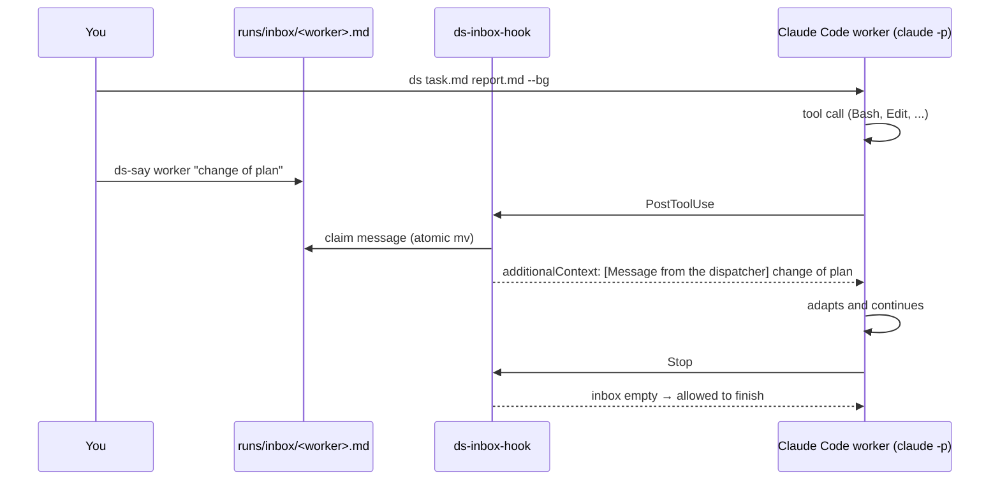

<div align="center">

# ds-worker

**Hand task sheets to headless Claude Code workers, and talk to them while they run.**

[](https://github.com/MuQY1818/ds-worker/actions/workflows/ci.yml)
[](LICENSE)


English · [简体中文](README.zh-CN.md)

</div>

---

You write a task sheet in Markdown. `ds` starts a headless [Claude Code](https://docs.anthropic.com/en/docs/claude-code)
session that works through it and writes a report. The worker can run on Claude itself or on any
Anthropic-compatible model, such as DeepSeek, so you can keep an expensive model for planning and
review and give the legwork to a cheap one.

Headless sessions normally cannot be steered once they start. **ds-worker adds an inbox.** `ds-say`
drops a message into it, and a Claude Code hook hands the message to the worker right after its next
tool call. No restart, and the worker keeps its context.

```console
$ ds tasks/setup-gpu-box.md reports/setup-gpu-box.md --bg
started  setup-gpu-box  (run setup-gpu-box.20261030-022451, pid 28504)
  log    ~/.local/state/ds-worker/runs/setup-gpu-box.20261030-022451.jsonl
  talk   ds-say setup-gpu-box "..."
  watch  ds-status setup-gpu-box -f

$ ds-say setup-gpu-box "The lerp clash is a C++20 name conflict: rename it inside cuRobo, don't patch RoboTwin."
queued for setup-gpu-box (delivered after its next tool call)

$ ds-status setup-gpu-box -f
  tool  Bash: tail -4 /root/logs/install_curobo.log
  inbox 02:25:13  The lerp clash is a C++20 name conflict: rename it inside cuRobo, don't patch RoboTwin.
  say   A dispatcher message arrived. Renaming lerp in cuRobo's helper_math.h and rebuilding.
  tool  Bash: sed -i 's/ lerp(/ lerp_curobo(/' src/curobo/curobolib/cpp/helper_math.h
  ...
```

## Features

- **Task sheet in, report out.** One Markdown file describes the job; the worker must write its report
  to the path you give, listing what it ran, what it produced and what failed.
- **Mid-run messages.** `ds-say <worker> "..."` reaches the worker after its next tool call. If the
  worker is about to finish with a message still waiting, it is held back until it has read it.
- **Any Anthropic-compatible backend.** Point `DS_BASE_URL` at DeepSeek, Kimi, GLM, a gateway, or
  leave it empty to use your own Claude login. Your main Claude Code session is not touched.
- **Background runs and a status view.** `--bg` detaches; `ds-status` lists runs as
  running / done / error / timeout, and `ds-status <worker> -f` follows one live, including delivered messages.
- **Guard rails.** A hard wall-clock timeout, a base rule set (report honestly, stay in scope, don't
  delete what you didn't create) and your own house rules appended to every worker.
- **Resume.** `--resume <session>` continues an earlier worker with a new task sheet as its next
  message, e.g. a correction note after you stopped it.
- **Small.** About 500 lines of bash and Python. No daemon, no server, no extra packages.

## How the inbox works



`ds` registers the hook for the worker only (through `claude --settings`), so nothing is added to your
global Claude Code settings. Each delivery is logged to `<run>.inbox.log`.

Delivery happens **between tool calls**. A worker blocked in one long foreground command reads the message
when that command returns, which is one more reason to run long jobs with `nohup` (see the example rules).

## Install

Requirements: [Claude Code](https://docs.anthropic.com/en/docs/claude-code) (`claude` on your PATH),
bash, python3 and perl. Tested on macOS and Linux.

```bash
git clone https://github.com/MuQY1818/ds-worker.git
cd ds-worker
./install.sh          # links ds, ds-say, ds-status into ~/.local/bin and creates the config
```

Then edit `~/.config/ds-worker/config.env`:

```bash
DS_BASE_URL=https://api.deepseek.com/anthropic   # any Anthropic-compatible endpoint; empty = your Claude login
DS_AUTH_TOKEN="$(cat ~/.secrets/deepseek)"        # the file is sourced by bash, so secrets can live elsewhere
DS_MODEL=deepseek-chat
```

See [`config.example.env`](config.example.env) for every setting.

## Usage

```bash
ds <task.md> <report.md> [--bg] [--name NAME] [--model M] [--effort low|medium|high]
                         [--timeout SECS] [--rules FILE] [--resume SESSION]
ds-say <worker> "message"            # or: echo "..." | ds-say <worker> -
ds-status                            # recent runs
ds-status <worker|run> [-n 50] [-f]  # last events of a run; -f follows it
```

The worker name defaults to the task file name without its extension (`tasks/fix-login.md` → `fix-login`).

### Writing a task sheet

The worker sees the task sheet as its whole assignment. Sheets that work well:

- **state the goal and the finish line**: what must exist or pass when the worker is done;
- **list what is off limits**: branches, files, machines, commands;
- **say what to do when stuck**: stop and report, rather than improvise around the problem;
- **ask for evidence**: commands, paths and numbers in the report, so you can check it quickly.

[`examples/inbox-demo.md`](examples/inbox-demo.md) is a one-minute task for trying the inbox, and
[`examples/rules.example.md`](examples/rules.example.md) is a starting point for house rules.

### Files

Everything for a run lives in `$DS_RUNS_DIR` (default `~/.local/state/ds-worker/runs`):

| File | Contents |
|---|---|
| `<run>.jsonl` | the worker's full stream-json transcript |
| `<run>.err` | stderr of the CLI |
| `<run>.inbox.log` | messages delivered through the inbox |
| `<run>.pid` / `<run>.exit` | present while running / exit code afterwards (142 = timeout) |
| `inbox/<worker>.md` | messages waiting for delivery |

## Safety

Workers run unattended, so by default they use Claude Code's `bypassPermissions` mode: **they can run
any command and edit any file your user can.** Run them where that is acceptable (a project directory,
a container, a rented GPU box), put limits in the task sheet and your rules file, or set a stricter
`DS_PERMISSION_MODE`. Keep tokens out of task sheets: they end up in transcripts.

## Development

```bash
bash tests/run.sh      # offline tests with a fake claude CLI
shellcheck -x bin/* libexec/ds-inbox-hook libexec/ds-common.sh install.sh tests/run.sh
```

Issues and pull requests are welcome.

## License

[MIT](LICENSE)
