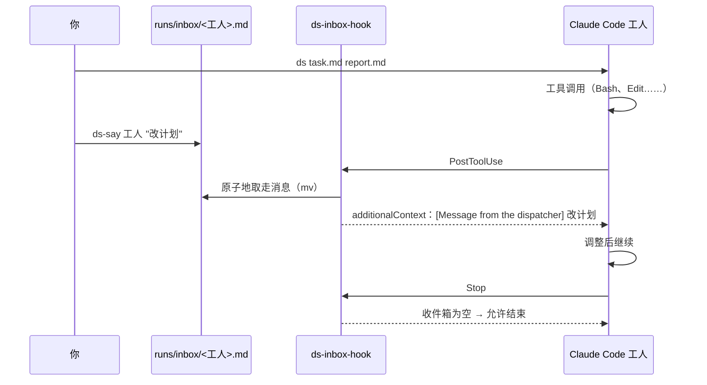

<div align="center">


# ds-worker

**把任务单交给无界面的 Claude Code 工人去做，并且能在它干活时插话。**

[](https://github.com/MuQY1818/ds-worker/actions/workflows/ci.yml)
[](LICENSE)

[English](README.md) · 简体中文

</div>

---

你用 Markdown 写一张任务单，`ds` 就启动一个无界面的 [Claude Code](https://docs.anthropic.com/en/docs/claude-code)
会话去执行，做完写一份报告。工人可以跑在 Claude 上，也可以跑在任何兼容 Anthropic 接口的模型上，比如 DeepSeek。
这样贵的模型留给你自己做规划和审查，跑腿的活交给便宜的模型。

无界面会话一旦开跑，通常就没法再干预。**ds-worker 加了一个收件箱**：`ds-say` 往里写一句话，Claude Code 的钩子会在
工人下一次工具调用结束后把话交给它。不用重启，工人的上下文也不会丢。

```console
$ ds tasks/setup-gpu-box.md reports/setup-gpu-box.md --bg
started  setup-gpu-box  (run setup-gpu-box.20261030-022451, pid 28504)
  log    ~/.local/state/ds-worker/runs/setup-gpu-box.20261030-022451.jsonl
  talk   ds-say setup-gpu-box "..."
  watch  ds-status setup-gpu-box -f

$ ds-say setup-gpu-box "lerp 冲突是 C++20 的重名问题：在 cuRobo 里改名，不要改 RoboTwin。"
queued for setup-gpu-box (delivered after its next tool call)
```

## 功能

- **任务单进，报告出**：一个 Markdown 文件描述任务。工人必须把报告写到你指定的路径，列出跑了什么、产出了什么、哪里失败了。
- **中途插话**：`ds-say <工人> "..."` 在工人下一次工具调用后送达。工人准备结束时如果还有没读的话，会被拦下，读完再走。
- **任意兼容 Anthropic 接口的后端**：`DS_BASE_URL` 可以指向 DeepSeek、Kimi、GLM 或者网关。留空就用你自己的 Claude 登录。不影响你主会话的配置。
- **后台运行和状态查看**：命令行有 `--bg` 时，`ds` 直接起一个 Claude Code 后台会话，`claude attach`、`claude agents` 和 SendMessage 都能找到这个工人；`--bg` 则是脱离终端跑 `claude -p`。`ds-status` 列出所有运行，分成运行中、完成、出错、超时；`ds-status <工人> -f` 实时跟随某个工人，插话的投递也会显示。
- **背景材料不用手抄**：`--context 文件`（可重复）让工人开工前先读；`--chat N` 把最近 N 轮对话摘成一份上下文；`--clone 仓库` 给它一个独立的工作副本。`--ask-to 名字` 让它遇到要拍板的问题时能给指定会话发消息。
- **护栏**：
  - 硬性的墙钟超时；
  - 一套基础规则：如实报告、不越界、不删不是自己创建的文件；
  - 每个工人都会追加你自己的规则文件；
  - 报告小于 300 字节不许收工，提醒两次后才放行。
- **续跑**：`--resume <session>` 接着之前的工人会话，把新任务单作为下一条消息发给它。比如你停掉工人之后，写一份纠正说明让它接着做。
- **小**：bash 加 Python 大约 1200 行。没有常驻进程，没有服务端，不需要额外装包。

## 两种后台模式

让工人离开终端自己跑，有两条路，它们不是一回事：

|  | `--native`（有 `claude --bg` 时的默认） | `--bg` |
|---|---|---|
| 跑的是什么 | Claude Code 后台会话 | 脱离终端的 `claude -p` 进程 |
| 对话记录 | Claude Code 自己的，在 `~/.claude/projects/` 下 | 运行目录里的 `<run>.jsonl` |
| 怎么找到它 | `claude attach <id>`、SendMessage、收件箱 | 收件箱、`ds-status -f` |
| `--timeout` | 到点用 `claude stop <id>` 停掉 | 给进程发 SIGALRM |
| 环境变量 | 不继承：后端写进设置文件，密钥由 key helper 现取 | 从 ds 继承 |
| 怎么接着聊 | `claude attach`，或者发消息 | `--resume` |

`claude --help` 里有 `--bg` 时默认用原生模式，否则走前台 `claude -p`。可以用 `--native` /
`--no-native` 指定，或者在配置里写 `DS_NATIVE=1|0|auto`。

后台会话在你运行 `ds` 的目录里启动，而 Claude Code 只会在它已经信任的目录里启动：先用 `claude`
打开一次那个目录，否则会话会卡在信任确认上。会话也不继承 `ds` 启动时的环境变量，所以 `ds` 会把
后端地址和模型写进设置文件，并用 `apiKeyHelper` 指向一个小脚本，在会话索取时从配置里现取
`DS_AUTH_TOKEN` —— 密钥本身不会落到任何文件里。

其余行为一致：两种工人注册的是同一个收件箱钩子，`ds-say` 都能找到，`ds-wait` 也都能等。

## 收件箱怎么工作



钩子只通过 `claude --settings` 注册给这个工人，不会写进你全局的 Claude Code 配置——后台会话用的也是它启动时那份设置文件。每次投递都记在 `<run>.inbox.log`。

同一个钩子在工人准备收工时验收报告：`<报告>` 不存在或者不到 300 字节，就把工人拦下让它先写报告；提醒两次之后放行，免得工人死循环。阈值可以用 `DS_REPORT_MIN` 改。

消息**在两次工具调用之间送达**。如果工人卡在一条很长的前台命令里，要等那条命令结束才收得到。所以长作业应该用 `nohup` 挂到后台，示例规则里也是这么要求的。

## 安装

需要：[Claude Code](https://docs.anthropic.com/en/docs/claude-code)（`claude` 在 PATH 里）、bash、python3、perl。在 macOS 和 Linux 上测过。

```bash
git clone https://github.com/MuQY1818/ds-worker.git
cd ds-worker
./install.sh          # 把 ds、ds-say、ds-status、ds-wait 链接到 ~/.local/bin，并生成配置文件
```

然后编辑 `~/.config/ds-worker/config.env`：

```bash
DS_BASE_URL=https://api.deepseek.com/anthropic   # 任意兼容 Anthropic 的地址；留空则用你的 Claude 登录
DS_AUTH_TOKEN="$(cat ~/.secrets/deepseek)"        # 这个文件由 bash 执行，密钥可以放在别处
DS_MODEL=deepseek-chat
```

全部选项见 [`config.example.env`](config.example.env)。

## 用法

```bash
ds <task.md> <report.md> [--native|--no-native] [--bg] [--name 名字] [--model 模型]
                         [--effort low|medium|high] [--timeout 秒] [--rules 文件]
                         [--resume 会话] [--context 文件]... [--chat N [--chat-from 记录]]
                         [--clone 仓库] [--ask-to 名字]
ds-say <工人> "话"                    # 或者：echo "..." | ds-say <工人> -
ds-wait <工人>                        # 等到它空闲或退出，然后打印报告状态和用量
ds-status                            # 最近的运行
ds-status <工人|运行> [-n 50] [-f]    # 某次运行的最后几条事件；-f 实时跟随
```

工人名默认取任务单文件名去掉扩展名（`tasks/fix-login.md` → `fix-login`）。

```console
$ ds tasks/port-feature.md reports/port-feature.md --chat 5 --context docs/spec.md --ask-to planning
started  port-feature  (background session 4f1c9a02)
  log    ~/.local/state/ds-worker/runs/port-feature.20261030-101500.launch
  report /home/me/work/reports/port-feature.md
  talk   ds-say port-feature "..."
  wait   ds-wait port-feature
  watch  ds-status port-feature -f
  attach claude attach 4f1c9a02

$ ds-wait port-feature
port-feature (4f1c9a02): idle; report /home/me/work/reports/port-feature.md (4182 bytes)
usage  input=21413 output=9871 cache_read=412880 cache_creation=20117 turns=42
last   Report written to reports/port-feature.md; tests pass.
```

`--chat N` 默认读 `~/.claude/projects` 下最近修改的对话记录，也可以用 `--chat-from` 指定；
工具结果、子代理（sidechain）的轮次和压缩摘要会被跳过。

### 怎么写任务单

对工人来说，任务单就是它的全部任务。好用的任务单通常：

- **写清目标和完成标准**：做完时什么东西必须存在，或者什么检查必须通过；
- **列出禁区**：哪些分支、文件、机器、命令不许碰；
- **写明卡住时怎么办**：停下来报告，而不是绕着问题自由发挥；
- **要求给证据**：报告里写命令、路径和数字，方便你快速核对。

[`examples/inbox-demo.md`](examples/inbox-demo.md) 是一个一分钟就能跑完的收件箱试用任务；
[`examples/rules.example.md`](examples/rules.example.md) 可以作为你自己规则文件的起点。

### 文件

每次运行的所有文件都在 `$DS_RUNS_DIR`（默认 `~/.local/state/ds-worker/runs`）：

| 文件 | 内容 |
|---|---|
| `<run>.jsonl` | 工人完整的 stream-json 记录（`claude -p` 运行） |
| `<run>.native` | 后台会话记录：短 id、会话 id、报告路径、超时 |
| `<run>.settings.json` | 工人启动时的设置：钩子；后台会话还包括后端 |
| `<run>.launch` | `claude --bg` 启动时的输出 |
| `<run>.err` | 命令行的 stderr |
| `<run>.inbox.log` | 通过收件箱送达的消息 |
| `<run>.pid` / `<run>.exit` | 运行中存在 / 结束后的退出码（142 表示超时） |
| `<run>.timeout` | 看门狗按 `--timeout` 停掉了会话 |
| `<run>.nag` | 报告提醒次数 |
| `<run>.context.md` | `--chat` 生成的上下文 |
| `clones/<工人>/repo` | `--clone` 生成的工作副本 |
| `inbox/<工人>.md` | 等待投递的消息 |

## 安全

工人无人值守，所以默认用 Claude Code 的 `bypassPermissions` 模式：**你的用户能跑的命令、能改的文件，它都能。**

- 请在可以接受这一点的地方运行：项目目录、容器、租来的 GPU 机器；
- 在任务单和规则文件里写清限制，或者把 `DS_PERMISSION_MODE` 设得更严；
- 不要把密钥写进任务单，因为任务单会原样进入运行记录。

## 开发

```bash
bash tests/run.sh      # 离线测试，用假的 claude 命令行
shellcheck -x bin/* libexec/ds-inbox-hook libexec/ds-common.sh libexec/ds-key-helper \
  libexec/ds-watchdog install.sh tests/run.sh tests/fake-claude
```

欢迎提 issue 和 PR。

## 许可

[MIT](LICENSE)
