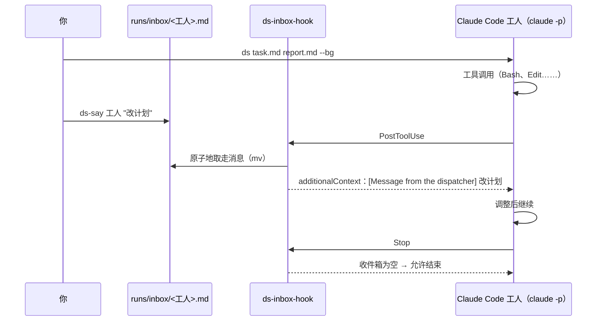

<div align="center">

# ds-worker

**把任务单交给无界面的 Claude Code 工人去做，并且能在它干活时插话。**

[](https://github.com/MuQY1818/ds-worker/actions/workflows/ci.yml)
[](LICENSE)

[English](README.md) · 简体中文

</div>

---

你用 Markdown 写一张任务单，`ds` 就启动一个无界面的 [Claude Code](https://docs.anthropic.com/en/docs/claude-code)
会话去执行，做完写一份报告。工人可以跑在 Claude 上，也可以跑在任何兼容 Anthropic 接口的模型上，比如 DeepSeek。
这样贵的模型留给你自己做规划和审查，跑腿的活交给便宜的模型。

无界面会话一旦开跑，通常就没法再干预。**ds-worker 加了一个收件箱**：`ds-say` 往里写一句话，Claude Code 的钩子会在
工人下一次工具调用结束后把话交给它。不用重启，工人的上下文也不会丢。

```console
$ ds tasks/setup-gpu-box.md reports/setup-gpu-box.md --bg
started  setup-gpu-box  (run setup-gpu-box.20261030-022451, pid 28504)
  log    ~/.local/state/ds-worker/runs/setup-gpu-box.20261030-022451.jsonl
  talk   ds-say setup-gpu-box "..."
  watch  ds-status setup-gpu-box -f

$ ds-say setup-gpu-box "lerp 冲突是 C++20 的重名问题：在 cuRobo 里改名，不要改 RoboTwin。"
queued for setup-gpu-box (delivered after its next tool call)
```

## 功能

- **任务单进，报告出**：一个 Markdown 文件描述任务。工人必须把报告写到你指定的路径，列出跑了什么、产出了什么、哪里失败了。
- **中途插话**：`ds-say <工人> "..."` 在工人下一次工具调用后送达。工人准备结束时如果还有没读的话，会被拦下，读完再走。
- **任意兼容 Anthropic 接口的后端**：`DS_BASE_URL` 可以指向 DeepSeek、Kimi、GLM 或者网关。留空就用你自己的 Claude 登录。不影响你主会话的配置。
- **后台运行和状态查看**：`--bg` 脱离终端运行。`ds-status` 列出所有运行，分成运行中、完成、出错、超时；`ds-status <工人> -f` 实时跟随某个工人，插话的投递也会显示。
- **护栏**：
  - 硬性的墙钟超时；
  - 一套基础规则：如实报告、不越界、不删不是自己创建的文件；
  - 每个工人都会追加你自己的规则文件。
- **续跑**：`--resume <session>` 接着之前的工人会话，把新任务单作为下一条消息发给它。比如你停掉工人之后，写一份纠正说明让它接着做。
- **小**：bash 加 Python 大约 500 行。没有常驻进程，没有服务端，不需要额外装包。

## 收件箱怎么工作



钩子只通过 `claude --settings` 注册给这个工人，不会写进你全局的 Claude Code 配置。每次投递都记在 `<run>.inbox.log`。

消息**在两次工具调用之间送达**。如果工人卡在一条很长的前台命令里，要等那条命令结束才收得到。所以长作业应该用 `nohup` 挂到后台，示例规则里也是这么要求的。

## 安装

需要：[Claude Code](https://docs.anthropic.com/en/docs/claude-code)（`claude` 在 PATH 里）、bash、python3、perl。在 macOS 和 Linux 上测过。

```bash
git clone https://github.com/MuQY1818/ds-worker.git
cd ds-worker
./install.sh          # 把 ds、ds-say、ds-status 链接到 ~/.local/bin，并生成配置文件
```

然后编辑 `~/.config/ds-worker/config.env`：

```bash
DS_BASE_URL=https://api.deepseek.com/anthropic   # 任意兼容 Anthropic 的地址；留空则用你的 Claude 登录
DS_AUTH_TOKEN="$(cat ~/.secrets/deepseek)"        # 这个文件由 bash 执行，密钥可以放在别处
DS_MODEL=deepseek-chat
```

全部选项见 [`config.example.env`](config.example.env)。

## 用法

```bash
ds <task.md> <report.md> [--bg] [--name 名字] [--model 模型] [--effort low|medium|high]
                         [--timeout 秒] [--rules 文件] [--resume 会话]
ds-say <工人> "话"                    # 或者：echo "..." | ds-say <工人> -
ds-status                            # 最近的运行
ds-status <工人|运行> [-n 50] [-f]    # 某次运行的最后几条事件；-f 实时跟随
```

工人名默认取任务单文件名去掉扩展名（`tasks/fix-login.md` → `fix-login`）。

### 怎么写任务单

对工人来说，任务单就是它的全部任务。好用的任务单通常：

- **写清目标和完成标准**：做完时什么东西必须存在，或者什么检查必须通过；
- **列出禁区**：哪些分支、文件、机器、命令不许碰；
- **写明卡住时怎么办**：停下来报告，而不是绕着问题自由发挥；
- **要求给证据**：报告里写命令、路径和数字，方便你快速核对。

[`examples/inbox-demo.md`](examples/inbox-demo.md) 是一个一分钟就能跑完的收件箱试用任务；
[`examples/rules.example.md`](examples/rules.example.md) 可以作为你自己规则文件的起点。

### 文件

每次运行的所有文件都在 `$DS_RUNS_DIR`（默认 `~/.local/state/ds-worker/runs`）：

| 文件 | 内容 |
|---|---|
| `<run>.jsonl` | 工人完整的 stream-json 记录 |
| `<run>.err` | 命令行的 stderr |
| `<run>.inbox.log` | 通过收件箱送达的消息 |
| `<run>.pid` / `<run>.exit` | 运行中存在 / 结束后的退出码（142 表示超时） |
| `inbox/<工人>.md` | 等待投递的消息 |

## 安全

工人无人值守，所以默认用 Claude Code 的 `bypassPermissions` 模式：**你的用户能跑的命令、能改的文件，它都能。**

- 请在可以接受这一点的地方运行：项目目录、容器、租来的 GPU 机器；
- 在任务单和规则文件里写清限制，或者把 `DS_PERMISSION_MODE` 设得更严；
- 不要把密钥写进任务单，因为任务单会原样进入运行记录。

## 开发

```bash
bash tests/run.sh      # 离线测试，用假的 claude 命令行
shellcheck -x bin/* libexec/ds-inbox-hook libexec/ds-common.sh install.sh tests/run.sh
```

欢迎提 issue 和 PR。

## 许可

[MIT](LICENSE)
